<!--
  GENERATED by scripts/gen_profile.py. Do not edit by hand.
  Edit profile.config.json and run: python3 scripts/gen_profile.py
  (the "Refresh profile" GitHub Action also does this daily with fresh stats)
-->

 
<a href="https://dionapp.com/">Dion</a> · <a href="https://withplum.com">Plum</a> · <a href="https://www.forth.gr/en/home/">FORTH</a> · <a href="https://www.onearmy.earth/">OneArmy</a>

 
 
 
 
 
 

 

